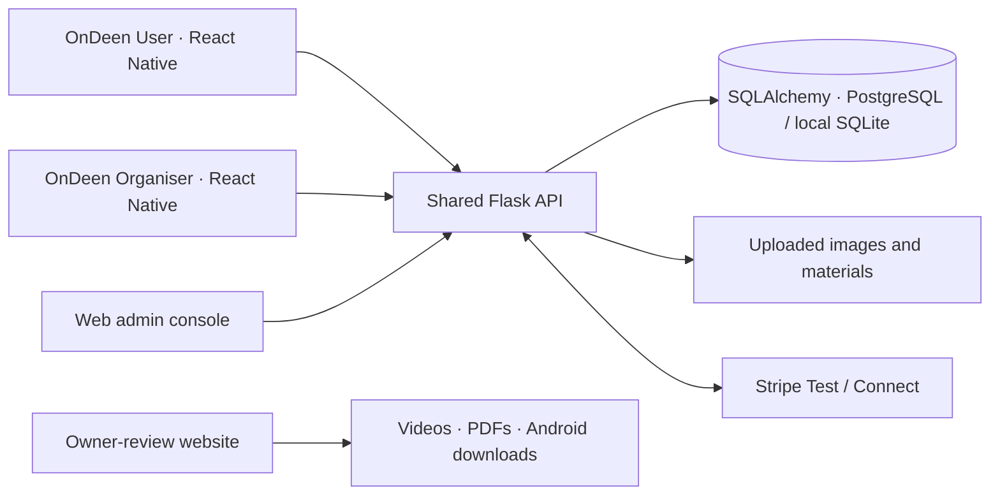

# OnDeen — React Native apps and shared backend

OnDeen connects Muslim communities with events, recurring courses, speakers and one-to-one sessions. Participants discover activities, book tickets, attend sessions and track their progress. Organisers publish activities, manage participants and attendance, communicate with their community and follow their payments.

**The mobile product developed in this repository consists of two React Native applications: `OnDeenUser` and `OnDeenOrganiser`, each with Android and iOS projects.** They share a Flask API and the same product data. The repository also includes the web admin console, the owner-review website, product references and recorded demonstrations.

A separate native Swift User app is retained in `OnDeenUserSwiftApp/` as an iOS reference. The User, Organiser and payment work presented in the owner-review package belongs to the **React Native apps and their shared backend**.

**[Open the owner review and demos](https://ondeen-owner-review-production.up.railway.app/)** · **[Open the web admin](https://ondeen-admin-web-production.up.railway.app/)**

**Taking over development?** Follow [Passation.md — Developer Handover](Passation.md) for Railway account setup, backend/data migration, Stripe configuration and the takeover checklist.

## Contents

- [Review the delivered product](#review-the-delivered-product)
- [What has been implemented](#what-has-been-implemented)
- [Architecture and repository map](#architecture-and-repository-map)
- [Set up a development environment](#set-up-a-development-environment)
- [Run and build the React Native apps](#run-and-build-the-react-native-apps)
- [Work on a feature](#work-on-a-feature)
- [Run checks and review evidence](#run-checks-and-review-evidence)
- [Run the admin and review website](#run-the-admin-and-review-website)
- [Deployment and troubleshooting](#deployment-and-troubleshooting)

## Review the delivered product

The [owner-review website](https://ondeen-owner-review-production.up.railway.app/) brings together five demonstrations, the source PDFs and two standalone Android builds. Start here to understand how the apps work together before opening the code.

| Review area | What the demonstration covers | Video |
| --- | --- | --- |
| User app | Discovery, booking, tickets, materials, notes, speakers, attendance and progression | [Watch User demo](https://ondeen-owner-review-production.up.railway.app/assets/videos/user-app-demo.mp4) |
| Organiser app | Applications, listings, recurring schedules, attendance, announcements, speakers and Buddy support | [Watch Organiser demo](https://ondeen-owner-review-production.up.railway.app/assets/videos/organiser-app-demo.mp4) |
| Shared P0 | Guest booking, notification links, shared event links, online check-in and Radar | [Watch shared P0 demo](https://ondeen-owner-review-production.up.railway.app/assets/videos/p0-demo.mp4) |
| Admin console | Sign-in and operational views of users, organisers, events and payments | [Watch Admin demo](https://ondeen-owner-review-production.up.railway.app/assets/videos/admin-web-demo.mp4) |
| Payments | Stripe Test orders, booking recovery, Organiser wallet, publishing, payout states and refunds | [Watch Payment demo](https://ondeen-owner-review-production.up.railway.app/assets/videos/payment-demo.mp4) |

Recommended order: **User → Organiser → shared P0 → Admin → Payments**. Here, **P0** means the core delivery scope shared across the two apps.

For hands-on Android review:

- [Download OnDeen User APK](https://ondeen-owner-review-production.up.railway.app/downloads/OnDeenUser-real-debug.apk)
- [Download OnDeen Organiser APK](https://ondeen-owner-review-production.up.railway.app/downloads/OnDeenOrganiser-real-debug.apk)

These are debug-signed, standalone `arm64-v8a` Android review builds. Their JavaScript is bundled, so they connect to Railway without a Metro server or a developer computer. Internet access and a compatible Android device are required. Store release signing is a separate step.

### Delivery and validation scope

The published review package is dated **6 September 2026**. Its demonstrations and linked reports document that delivery checkpoint; they are not a fresh test run of every later checkout.

The payment demonstrations use **Stripe Test mode**. The payment implementation includes server-priced orders, signed webhooks, booking fulfilment, the financial ledger, refunds and payout processing. Apple Pay and Google Pay still require matching Stripe account configuration, platform provisioning and device validation. The tracked support-delivery gate also requires a configured mail provider and a real delivery check.

For exact scenario status, consult the [requirement ledger](REFS_IMPLEMENTATION_BLUEPRINT/requirements/REQUIREMENTS.tsv), [payment evidence manifest](REFS_IMPLEMENTATION_BLUEPRINT/evidence/payment-p0/PAYMENT_EVIDENCE_MANIFEST.md) and [platform-wallet handoff](REFS_IMPLEMENTATION_BLUEPRINT/implementation/PAYMENT_PLATFORM_WALLET_GATE.md). Earlier blueprint and non-payment reports describe earlier phases and can still say that payments were deferred; the [consolidated payment proof](<VIDEOS_PROOF/User App & Organizer App Payment REF/README.md>) describes the subsequent implementation.

## What has been implemented

### User app — discover, book and attend

`OnDeenUser/` contains the participant-facing React Native app:

- Account registration, login, phone/OTP entry, profile and privacy settings.
- Category-based discovery, event details, locations, organisers, speakers and recurring-course schedules.
- Free and paid booking paths, ticket quantities, guest booking for eligible single-session listings, booking history and downloadable QR tickets.
- In-app calendars and adding booked sessions to the device calendar.
- Event materials, personal notes, participant lists and questions answered by organisers.
- Buddy requests and one-to-one session requests with their lifecycle states.
- Onsite and online check-in, session feedback, XP, Seeker levels and attendance-based Radar progress.
- Notification inbox navigation, event sharing, deep links, help and issue-report forms.

### Organiser app — publish and operate

`OnDeenOrganiser/` contains the React Native workspace for organisers, with role-specific Speaker and Buddy flows:

- Organiser registration/application, approval and workspace access.
- Dashboard, listing history, analytics and calendar views.
- Event and course creation, drafts, editing, publishing, recurrence, ticket types and capacity.
- Listing classification, delivery mode, eligibility, information and materials.
- Participant lists, QR scanning, attendance management and attendance overrides.
- Announcements, attendee questions, notification preferences and event updates.
- Speaker management, one-to-one sessions and Buddy assignments.
- Stripe Connect readiness for paid publishing, wallet balances, paginated transaction history, refund decisions and payout states.

### Shared behaviour and gamification

The backend coordinates changes across both apps: a booking appears in the Organiser participant list; an announcement or material update reaches the User inbox; confirmed attendance updates the participant's progression.

Verified attendance drives XP and the **Knowledge, Fitness, Community and Tazkiyyah** Radar axes. Radar uses a rolling 30-day view, while XP represents cumulative progress. Guest rules, online attendance windows, notification targets and event deep links are shared product rules. Challenges and certificates remain future scope in the reference ledger.

### Payments and operations

The payment domain covers the full relationship between buyer, organiser and platform:

1. The backend validates the listing, ticket quantity and price, using GBP amounts in integer pence.
2. Stripe Test payment confirmation is processed through signed webhooks; repeated events must not create duplicate bookings or ledger entries.
3. The User receives the booking/ticket, and the Organiser sees the matching sale, fee and net amount.
4. Refund requests, partial/full refunds, cancellations, payout eligibility and failure/retry states remain linked to the order and ledger.

Free bookings retain their own path without creating payment transactions. The payout worker has a separate enable flag; a recorded payout rehearsal does not mean that a persistent worker is enabled in every environment.

The web admin provides operational views of users, organisers, speakers, listings, orders, refunds and payouts using the same backend as the mobile apps.

## Architecture and repository map



The review website serves the delivery material. The admin is a separate operational application. Neither is the mobile app's runtime.

```text
onDeenApp/
├── OnDeenUser/                    React Native participant app: Android + iOS
├── OnDeenOrganiser/               React Native organiser app: Android + iOS
├── Backend/                      Flask API, models, services, seeds and tests
├── ondeen_admin_web_interface/    Web admin and its Node HTTP server
├── report/                       Owner-review website, demos and reference PDFs
├── REFS/                         Original Product Owner references
├── REFS_IMPLEMENTATION_BLUEPRINT/ Requirement ledger, implementation notes and evidence
├── VIDEOS_PROOF/                  Requirement-level and consolidated video proofs
├── docs/                         Product scope, testing and UI-parity documentation
├── OnDeenUserSwiftApp/            Separate native Swift User reference
├── .ios-run/                     iOS UI driver; generated run output is ignored
├── build.sh                      Build both React Native Android review APKs
└── run-ios.sh                    Run either or both React Native iOS apps
```

Each mobile app has its own `package.json`, dependencies, native projects and patches. Install dependencies **inside each app directory**; there is no root npm workspace.

| Component | Stack in this checkout | Main entry points |
| --- | --- | --- |
| User mobile app | React 19, React Native 0.78.3 in the npm lockfile, JavaScript/TypeScript, Redux Toolkit, React Navigation | [App.jsx](OnDeenUser/App.jsx), [src/](OnDeenUser/src/), `android/`, `ios/` |
| Organiser mobile app | React 18.3.1, React Native 0.75.2, JavaScript/TypeScript, Redux Toolkit, React Navigation | [App.tsx](OnDeenOrganiser/App.tsx), [src/](OnDeenOrganiser/src/), `android/`, `ios/` |
| Shared API | Python, Flask, SQLAlchemy, JWT, Stripe SDK; PostgreSQL on Railway, SQLite for local work | [wsgi.py](Backend/wsgi.py), [app/](Backend/app/) |
| Admin and review sites | HTML, CSS, browser JavaScript and small Node HTTP servers | [Admin server](ondeen_admin_web_interface/server.js), [review server](report/server.js) |

Keep the two apps' dependency versions and `patches/` directories intact when setting up. Their React Native versions differ, so upgrading one app is a separate change from upgrading the other.

The API groups routes under `/customer_app/`, `/organizer_app/`, `/speaker_app/`, `/buddy_app/`, `/admin_app/` and `/payment/`. Shared authentication and uploads include `/generate_token` and `/image_upload`.

## Set up a development environment

All commands below start from the repository root unless a `cd` is shown.

### Prerequisites

- Node.js and npm; the package manifests declare Node `>=18`.
- Python 3.11 for the backend, matching [Backend/Dockerfile](Backend/Dockerfile).
- Android SDK/platform tools, `adb` and a compatible JDK. The Android projects declare SDK/build tools 35 for User, 34 for Organiser, and NDK `26.1.10909125`; check their Gradle files when preparing the machine.
- For iOS: macOS, full Xcode, an installed iOS Simulator runtime and CocoaPods compatible with the app Gemfiles.
- Backend native libraries where needed: `libmagic` for file detection and `wkhtmltopdf` for PDF generation, also listed in the Dockerfile.

### 1. Install mobile dependencies

```bash
(cd OnDeenUser && npm install)
(cd OnDeenOrganiser && npm install)
```

The `postinstall` hook applies the repository's `patch-package` fixes. Review any lockfile changes before committing them.

### 2. Prepare the local backend

```bash
cd Backend
python3.11 -m venv .venv
source .venv/bin/activate
pip install -r requirements.txt
test -f .env || cp .env.example .env
```

The last command preserves an existing `.env`. Before starting or seeding, confirm that your local file uses the intended **local SQLite database**:

```dotenv
ONDEEN_ENV=local
ONDEEN_LOCAL=1
ENV=local
DATABASE_URL=sqlite:///ondeen-local.db
FLASK_RUN_HOST=0.0.0.0
FLASK_RUN_PORT=8088
ENABLE_SCHEDULER=false
SMS_SEND_ENABLED=false
EMAIL_SEND_ENABLED=false
```

[Backend/.env.example](Backend/.env.example) contains the rest of the local settings. The template's secrets and OTP configuration are development defaults. Keep provider credentials in environment configuration, outside documentation and commits.

### 3. Create reference data and start the API

From `Backend/`, on a disposable local database:

```bash
./seed.sh local refs
./run.sh local
```

**Seeding resets the target database.** Confirm `DATABASE_URL` before using any seed command. A local mode argument does not make an existing remote database URL safe to reset.

| Seed profile | Intended use |
| --- | --- |
| `refs` | Product Owner reference names, listings, speakers, materials, participants and related demo content; no paid transaction fixture |
| `basic` | Smaller development dataset with events and bookings |
| `complete` / `advanced` | Basic data plus progression, feedback, online check-in codes and notification links |

`ONDEEN_SEED_EVENT_BASE_DATE` controls the date anchor used by the basic/complete seed. Review the fixture dates when testing attendance or future bookings.

The runner listens on port `8088` and prints the machine's LAN URL. To restart it explicitly, use `RUH_RESTART=1 ./run.sh local` from `Backend/`.

### 4. Choose the backend the apps will use

| Target | URL/configuration |
| --- | --- |
| Existing Railway review API | `https://api-production-517c1.up.railway.app` |
| Local API from the same computer or an iOS simulator | `http://127.0.0.1:8088` |
| Local API from a physical phone | The computer's LAN address, such as `http://192.168.1.23:8088`; both devices must be on the same network |
| Local API from the standard Android emulator | `http://10.0.2.2:8088`, or a deliberately configured `adb reverse` connection |

Both apps' source configuration currently points to Railway. The **root Android build helper defaults to the computer's LAN backend**, while the **root iOS runner defaults to Railway**. Set the target deliberately when switching between local development and the shared review environment.

For Android review builds, pass `ONDEEN_REAL_BACKEND_URL` as shown below. For ordinary Metro development, check the API constants in [User](OnDeenUser/src/helpers/Constant.tsx) and [Organiser](OnDeenOrganiser/src/helpers/Constant.tsx), including the Organiser file base URL. These environment overrides are implemented by the build helpers; they are not automatically consumed by every `npm start` invocation.

## Run and build the React Native apps

### Android: build standalone APKs

From the repository root, build both apps against the running local backend:

```bash
ONDEEN_REAL_BACKEND_URL=http://192.168.1.23:8088 ./build.sh realDebug
```

Replace the example address with the URL printed by your backend. To build against the review API:

```bash
ONDEEN_REAL_BACKEND_URL=https://api-production-517c1.up.railway.app ./build.sh realDebug
```

Use `userRealDebug` or `organiserRealDebug` instead of `realDebug` to build one app.

The default output directory is `~/Downloads/SHARED/`:

```text
OnDeenUser-real-debug.apk
OnDeenUser-real-debug.txt
OnDeenOrganiser-real-debug.apk
OnDeenOrganiser-real-debug.txt
```

The text manifests record build information. Set `ONDEEN_APK_DEST_DIR` to choose another output directory.

Each app also has its own helper. For example, to build, install and launch User on a connected Android device:

```bash
cd OnDeenUser
ONDEEN_REAL_BACKEND_URL=http://192.168.1.23:8088 ./build.sh installRealDebug
```

| Per-app mode | Behaviour |
| --- | --- |
| `debug` / `installDebug` | Bundle with `--dev true`; development bypasses or mock fallbacks may be active |
| `realDebug` / `installRealDebug` | Bundle with `--dev false`, use the selected real API and retain a debug Android signature |
| `test` | Run that app's Jest tests |

Use `realDebug` for reviewing actual API behaviour. It is the mode used for the standalone review package.

### Android: edit with Metro

For fast UI iteration, use separate terminals. Example for User:

```bash
# Terminal 1
cd OnDeenUser
npm start -- --port 8081
```

```bash
# Terminal 2
cd OnDeenUser
npm run android -- --port 8081
```

For Organiser, use `OnDeenOrganiser/` and port `8082` in both commands. Configure the API address before testing local data. Restart Metro or rebuild when changing native configuration or switching away from a previously bundled standalone build.

### iOS: run the React Native apps

After installing mobile dependencies and preparing Xcode/CocoaPods:

```bash
./run-ios.sh doctor
ONDEEN_IOS_RESET_APP_DATA=0 ./run-ios.sh user
ONDEEN_IOS_RESET_APP_DATA=0 ./run-ios.sh organiser
```

Use `both` to run both apps. The runner handles CocoaPods, build/install and launch, and writes logs under `.ios-run/`. Its default simulator names are `iPhone 15 Pro` for User and `iPhone 17 Pro` for Organiser; override them with `ONDEEN_USER_IOS_SIMULATOR` and `ONDEEN_ORGANISER_IOS_SIMULATOR` to match installed targets.

By default, simulator builds include JavaScript bundled with `--dev false` and use Railway. To iterate with Metro:

```bash
ONDEEN_IOS_RESET_APP_DATA=0 ONDEEN_IOS_USE_BUNDLED_JS=0 ./run-ios.sh user
```

The runner uses Metro ports `8081` for User and `8082` for Organiser. The examples preserve app data: without `ONDEEN_IOS_RESET_APP_DATA=0`, the runner defaults to a clean app installation.

The root `run-ios.sh` operates on the **React Native apps**. The separate [Swift reference README](OnDeenUserSwiftApp/README.md) documents its own setup and runner.

## Work on a feature

Start with the expected product behaviour and follow it through every affected component.

1. Open the matching source in [REFS/](REFS/) and find its requirement in the [ledger](REFS_IMPLEMENTATION_BLUEPRINT/requirements/REQUIREMENTS.tsv).
2. Watch the corresponding review video and read the relevant implementation note. This gives you the expected screens, transitions and cross-app result.
3. Trace the screen, state/API call, backend route, service and model before editing. For a booking or payment change, include both User and Organiser views.
4. Implement the change while preserving existing navigation, persisted state and the established visual baseline.
5. Run the affected automated checks, then replay the interaction in an installed app against the intended backend.
6. Update the requirement evidence or implementation note with what was checked, on which platform and against which environment.

| Work area | Where to look |
| --- | --- |
| Screens and shared components | `OnDeenUser/src/screens/`, `OnDeenOrganiser/src/screens/`, each app's `src/components/` |
| Navigation and links | Each app's `src/navigation/`; `OnDeenUser/src/linking/` |
| App state and API access | Each app's `src/redux/`, `src/services/` and `src/helpers/` |
| Backend routes and business rules | `Backend/app/`, `Backend/app/services/`, `Backend/app/repositories/`, `Backend/app/models/` |
| Payment contract | [Routes](Backend/app/payment/routes.py), [service](Backend/app/services/payment.py), [models](Backend/app/models/payment.py) |
| Admin interface | `ondeen_admin_web_interface/` and `Backend/app/admin_app/` |
| Review content | [report/index.html](report/index.html), `report/site.css`, `report/assets/` |

Payment rules are enforced by the backend. Preserve server-side pricing, webhook signature checks, idempotent fulfilment and ledger consistency when changing the mobile checkout or wallet UI. Payment Test configuration includes `PAYMENT_P0_ENABLED`, `STRIPE_SECRET_KEY`, `STRIPE_WEBHOOK_SECRET` and `STRIPE_CONNECT_WEBHOOK_SECRET`; the mobile publishable key must belong to the same Stripe account. `PAYMENT_PAYOUT_WORKER_ENABLED` controls a separate financial worker and is disabled by default.

Useful supporting documents:

- [Original P0 scope](ondeen-v2-p0-scope.md)
- [Source reference manifest](REFS_IMPLEMENTATION_BLUEPRINT/SOURCE_MANIFEST.md)
- [Repository and feature map](REFS_IMPLEMENTATION_BLUEPRINT/CURRENT_REPOSITORY_MAP.md)
- [P0 testing guide](docs/p0-testing-guide.md)
- [React Native / Swift visual-parity notes](docs/swift-react-native-parity/index.md)
- [Consolidated payment video guide](<VIDEOS_PROOF/User App & Organizer App Payment REF/README.md>)

## Run checks and review evidence

### Mobile unit tests and lint

```bash
(cd OnDeenUser && npm test -- --runInBand)
(cd OnDeenOrganiser && npm test -- --runInBand)
```

Each app also exposes `npm run lint`. Run checks for the affected app and inspect any existing failures separately from your change.

### Backend regression tests

From `Backend/`, with its virtual environment active:

```bash
python -m unittest discover -s tests -p 'test_local_critical.py'
python -m unittest discover -s tests -p 'test_payment_p0.py'
```

These suites configure isolated in-memory SQLite databases. The payment suite mocks provider calls; its success does not replace a real Stripe Test interaction.

### Local authentication API E2E

The mobile test scripts cover HTTP authentication/registration contracts. Some defaults still reference the old `ondeen/` directory, so pass the current backend path explicitly from the repository root:

```bash
BACKEND_DIR="$PWD/Backend" BASE_URL=http://127.0.0.1:8088 ./OnDeenUser/tests/run-all.sh
BACKEND_DIR="$PWD/Backend" BASE_URL=http://127.0.0.1:8088 ./OnDeenOrganiser/tests/run-all.sh
```

Use a disposable local database: these scripts create/reset test accounts and seed reference data. They do not drive a phone UI. Optional `tests/e2e.env` files can override their settings; check them when diagnosing a target mismatch.

The separate [Railway E2E script](Backend/tests/railway_e2e.py) exercises a remote environment and can create test data. Treat it as an intentional shared-environment test, outside the ordinary local loop.

### Installed-app acceptance

For a change that affects both apps, verify the complete result: perform the User action, inspect its Organiser/Admin counterpart, refresh or relaunch, and confirm that the state persists. Include loading, empty, failure and retry states where relevant.

The [.ios-run UI driver guide](.ios-run/README.md) documents existing XCUITest tooling. Existing videos and dated reports provide regression references; record fresh evidence when behaviour changes.

## Run the admin and review website

Both websites have a small Node server and no runtime npm dependencies.

Run the admin against the local backend:

```bash
cd ondeen_admin_web_interface
ONDEEN_API_URL=http://127.0.0.1:8088 PORT=8080 npm start
```

Open `http://localhost:8080`. Omit `ONDEEN_API_URL` to use its default Railway API. These are server environment variables; copying `.env.example` alone does not load them. Use an account provisioned in the target backend and check whether the console is showing connected data or its labelled preview mode.

In another terminal, serve the review site:

```bash
cd report
PORT=8081 npm start
```

Open `http://localhost:8081`. Choose another port if User Metro is running on `8081`. Videos and PDFs are under `report/assets/`; local APK downloads require the corresponding files in `report/downloads/`. The hosted service reads APKs from its persistent volume.

## Deployment and troubleshooting

### Railway services

The review environment has separate services for the backend (`api`), web admin (`ondeen-admin-web`) and owner review (`ondeen-owner-review`). Deploy the component you changed using its own directory as the service root.

- **Backend:** [Backend/scripts/deploy_railway.sh](Backend/scripts/deploy_railway.sh) wraps a Railway upload with `--path-as-root`. Verify the linked project, service and environment first. Production variables, PostgreSQL and upload storage belong to the service configuration.
- **Admin:** deploy `ondeen_admin_web_interface/`; its start command is `npm start`, with `ONDEEN_API_URL` selecting the API.
- **Review website:** [report/deploy.sh](report/deploy.sh) uses a local `railway-secure` wrapper. It checks for the local videos, PDFs and both APKs before deployment. Existing hosted APKs are preserved unless `RAILWAY_UPLOAD_APKS=1` is explicitly set for new binaries.

After a deployment, wait for that exact deployment to succeed and check its public behaviour. Database seeding is a separate, destructive maintenance action; it is not a normal deployment step.

### Common issues

| Symptom | Check |
| --- | --- |
| Phone cannot reach the local API | Use the computer's LAN IP, port `8088`, the same network and a reachable firewall configuration. `localhost` on a physical phone refers to the phone. |
| App shows demo/fallback data | Check whether JavaScript was built with `--dev true`. Use `realDebug` for backend review and confirm the bundled API URL. |
| User and Organiser show different data | Check both API targets, the signed-in accounts, cached state and the installed build. |
| Wrong screen bundle or Metro connection | Use separate Metro ports for the two apps and rebuild/restart after switching build modes. |
| An API test looks for `ondeen/` | Pass `BACKEND_DIR="$PWD/Backend"` from the repository root. |
| iOS state disappears after running the helper | Set `ONDEEN_IOS_RESET_APP_DATA=0` to preserve simulator app data. |
| Local check-in is unavailable | Check fixture dates, session time zones, booking state and the permitted attendance window. |
| PaymentSheet cannot find an order's PaymentIntent | Verify that the mobile publishable Test key and backend Test key belong to the same Stripe account; consult the platform-wallet handoff. |
| Sign-in provider, push, e-mail or platform wallet is unavailable | Check the relevant mobile/provider configuration and feature flags. The User app currently disables Google sign-in and FCM delivery by default; inbox navigation is a separate feature. |

Keep `.env` credentials, dependencies, native build output, local databases and generated test artifacts out of commits. Retain source references, app patches and the evidence needed to explain a delivered change.
